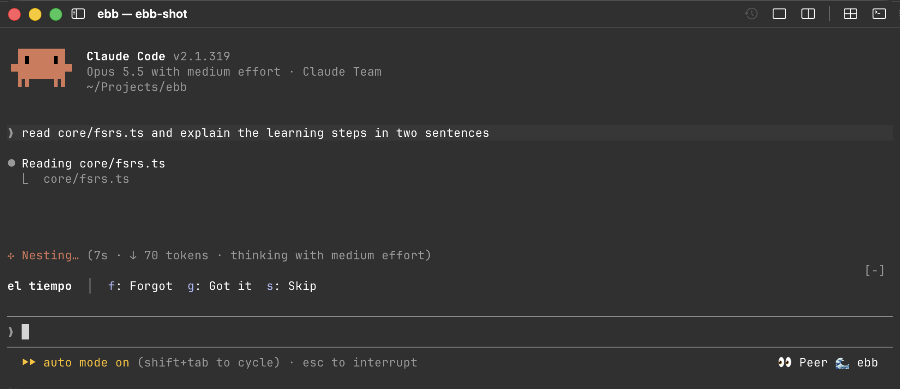
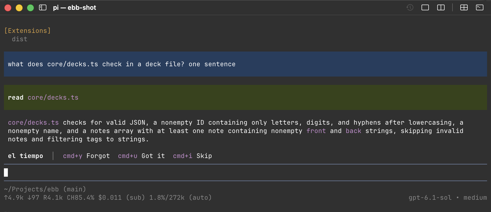

# ebb

**Learn while your agent thinks.**

You wait for Claude Code or pi dozens of times a day. ebb turns those seconds into a language, or any other skill you want to keep: one card above the prompt, one key to grade it, and back to work.



Site and decks: <https://r13v.github.io/ebb/>

## Why ebb

- **It uses time you already lose.** A card takes a few seconds, and an agent turn takes longer. Fifty turns a day are fifty reviews, with no new habit to keep.
- **It never gets in your way.** One line above the prompt. No pop-up, no sound, no focus stolen. Skip a card, hide the band, or ignore it: your prompt stays yours.
- **It remembers for you.** FSRS-6, the scheduler that Anki uses, brings each card back just before you would forget it. A word you know waits weeks; a word you missed comes back in a minute.
- **Decks in one command.** `/ebb add Spanish words for a bar` writes the notes, checks each one by translating it back, and lets you tick the ones to keep. Ask in your own language; the answers come in it.
- **A deck to start with.** About 2000 words, phrases and idioms of Castilian Spanish with Russian translations, one command away.
- **Claude Code and pi, one memory.** Grade a card in one agent, and the other knows. Your data is a local JSON file; nothing leaves your machine except the model calls of `/ebb add`.

## Quick start

1. Install ebb in your agent (below), then restart it.
2. Install a deck, or make one:

   ```text
   /ebb install https://r13v.github.io/ebb/decks/es-ru.json
   /ebb add Spanish words for ordering at a bar
   ```

3. Work as usual. When a card shows above the prompt, grade it: Got it brings the next card, Forgot shows the answer first.

## Install

### Claude Code

```sh
claude plugin marketplace add r13v/ebb
claude plugin install ebb@ebb
```

Then restart Claude Code.

- The band above the prompt shows one card: `el corazón  │  y: Forgot  u: Got it  i: Skip`.
- Got it brings the next card at once. Forgot shows the answer, with the note's hint if it has one: `el corazón — heart  │  y: Next`.
- The `🌊 ebb` button under the prompt hides the band and shows it again.

To update, open `/plugin` in Claude Code, or run:

```sh
claude plugin marketplace update ebb
claude plugin update ebb@ebb
```

Every change of the plugin on `main` gets a new version and a `v*` tag (`.github/workflows/release.yml`), so these commands see it.

### pi

```sh
pi install npm:pi-ebb
```



The commands are the same `/ebb` commands. The card shows above the editor. Grade it with a shortcut or a click; the editor keeps every key you type:

- `cmd+y` (`super+y` off a Mac): Forgot, and Next after the answer.
- `cmd+u`: Got it.
- `cmd+i`: Skip.
- `ctrl+0`: hide or show the card. It stays as you left it in new sessions.
- Or click a button of the band. pi passes clicks in its fullscreen mode, the default.

`cmd` reaches pi in Ghostty and agterm, through the kitty keyboard protocol. Other terminals, such as Terminal.app and iTerm2, keep `cmd` for themselves: click the band there, or set your own keys in `$XDG_DATA_HOME/ebb/pi.json` and restart pi:

```json
{"keys": {"forgot": "alt+1", "got": "alt+2", "skip": "alt+3", "toggle": "alt+0"}}
```

`/ebb add` uses the model of the session and shows the notes in a list: press `1` to `9` to tick a note, `a` to add the ticked notes, `x` or Escape to cancel.

## Get cards

ebb comes with no cards. Make a deck, or install one.

- **Make one:** `/ebb add <topic>`. Write the request in your own language, for example `/ebb add испанские слова для бара` or `/ebb add Spanish words for a bar`. Claude takes the language you learn from the request and gives the answers in the language you write in. If it cannot tell your language, the pane asks once. A topic that is not about a language, such as `/ebb add @k8s pods`, makes a deck of questions and answers.
- **Install one:** `/ebb install <file or URL>` adds a deck file. For example, about 2000 words, phrases and idioms of Castilian Spanish with Russian translations:

  ```text
  /ebb install https://r13v.github.io/ebb/decks/es-ru.json
  ```

  Install the same file again to get its new notes. Your cards keep their schedule.

  Every deck in `decks/` of this repository is on the site, with a button that copies its install command. To share a deck, add its file to `decks/` in a pull request.

The band shows the cards of one deck, the active deck. Until you choose one, the active deck is the deck you reviewed last, or your first deck. To study another deck, type `/ebb use @<deck>`. Another deck from `/ebb install` or `/ebb add @<deck>` does not become active. The due cards of the other decks wait; `/ebb decks` shows how many.

### Deck file

A deck file is JSON:

```json
{
  "id": "es-en",
  "name": "Spanish for English speakers",
  "learn": "Spanish",
  "native": "English",
  "guidance": "Nouns carry their article.",
  "notes": [
    {"front": "el agua", "back": "water", "hint": "el, although agua is feminine", "tags": ["noun"]}
  ]
}
```

- `id` and `name` are necessary. The `id` has lowercase letters, digits and hyphens.
- `learn` and `native` make a language deck: the language you learn and the language of the answers. Without them, the deck asks questions in one direction only.
- `guidance` is optional: more instructions for the notes that `/ebb add` writes in this deck.
- New cards come in the order of `notes`.

## Commands

| Command | Result |
|---|---|
| `/ebb` | Shows the counts and the commands. |
| `/ebb install <file or URL>` | Adds a deck file, or the new notes of a deck file you installed before. |
| `/ebb decks` | Lists your decks with their cards, due cards and new cards. `▶` marks the active deck. |
| `/ebb use @<deck>` | Makes the deck active: the band shows only its cards. |
| `/ebb add <topic>` | Claude writes up to 9 new notes on the topic for the active deck. In a language deck, a second model call translates each note back and flags the notes that do not match. You select the notes to add. |
| `/ebb add @<deck> <topic>` | The same for a named deck. ebb creates the deck on first use. |
| `/ebb pause [1h\|30m\|2d\|off]` | Hides the band for that time. The default is 1 hour. |
| `/ebb stats` | Shows the number of notes, due cards and new cards in the active deck. |

In the band above the prompt:

- Click a button, or press `ctrl+x tab` to move the keys to the band and then press its key.
- Press `y` (Forgot) or `u` (Got it) to grade the card. Each button shows its key. The keys sit side by side, and they are the letters of the pi shortcuts.
- After Forgot, the band shows the answer; press `y` (Next) for the next card.
- Press `i` to skip the card. A skipped card comes back when no other card is left.
- Press Escape to return to the prompt.
- Click `🌊 ebb` under the prompt to hide or show the band. It stays as you left it in new sessions.

In the pane of `/ebb add`:

- Press `1` to `9` to tick or untick a note. A note marked `[have]` is in the deck already and cannot be ticked.
- Press `a` to add the ticked notes, or `x` to cancel.
- If the back-translation fails, no note is ticked and the pane says so. Check the notes yourself.

## How cards are scheduled

- A new note gets a recognition card (for example Spanish → Russian).
- In a language deck, when the recognition card reaches a stability of 21 days, ebb adds a production card (Russian → Spanish). A deck of facts asks in one direction only.
- The band takes cards of the active deck only.
- The band takes due cards and new cards in turns, as Anki mixes new cards with reviews. New cards come in deck order, up to 20 each day for each deck. Then new production cards: they are words you know already, so they do not count toward the 20. To change the number, set `newPerDay` on the deck in `data.json`.
- A card you just graded or skipped never comes straight back while another card is left. A learning card waits for its step.
- Learning steps are 1 minute and 10 minutes. The relearning step is 10 minutes.
- When nothing is scheduled, the band runs ahead: new cards past the daily limit, then the card that comes due soonest. So it always has a card.
- Only a grade changes a schedule. Skipping a card does not.
- At the end of each turn, a card whose answer is hidden makes way for a card that came due.
- When a deck file has the same front twice, the note gets the meanings of both: `mejor` is `лучший; лучше`.

The terms are defined in [CONTEXT.md](CONTEXT.md).

## Data

All data is in `$XDG_DATA_HOME/ebb/`, by default `~/.local/share/ebb/`. Claude Code and pi use the same files:

- `data.json` holds the decks, notes and card schedules.
- `log/<YYYY-MM>/<session>.json` holds the reviews of one session.

Each session writes only its own log file. A change to `data.json` takes a lock (`lock` in the same folder) and reads the file again before it writes. Thus two open sessions, also one in Claude Code and one in pi, do not lose each other's grades. A lock that is older than 10 seconds is removed.

## Development

The tools and tasks are in `mise.toml`. Install [mise](https://mise.jdx.dev), then:

```sh
mise install      # Node.js, hk, the npm tools and the Git hook
mise run dev      # a Claude Code session with the mod of this checkout
mise run verify   # Biome, Knip, TypeScript, validation and the tests
mise run live     # inside agterm: a real session with the mod, its band with a card
mise run pi:dev   # a pi session with the extension of this checkout
mise run pi:build # the pi extension into pi/dist/ with Vite
```

`mise run dev` loads the mod from the checkout; Claude Code reloads it when a turn ends after a change. It also writes `.claude-plugin/types/`, which `mise run typecheck` needs. `mise run site` builds the site into `_site/` (GitHub Actions publishes it on a push to `main`).

The FSRS tests use the test vectors of py-fsrs. Commit messages follow [Conventional Commits](https://www.conventionalcommits.org): `feat:` and `fix:` publish a new version of the pi package. The rules for code and documents are in [AGENTS.md](AGENTS.md) and [docs/](docs).
