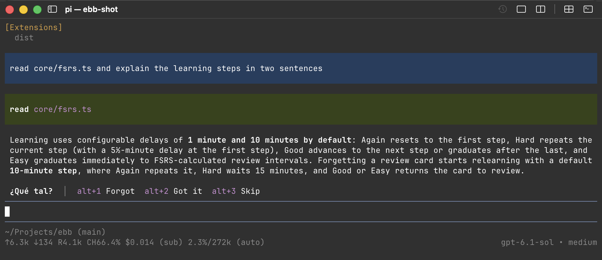

# pi-ebb

**Learn while your agent thinks.** Spaced repetition in the background of [pi](https://pi.dev): one card above the editor while pi works, graded with one shortcut. A language, or any other facts you want to keep.



- **No new habit.** It uses the seconds you already wait for the agent.
- **Never in your way.** Grade with `alt+1`, `alt+2` or a click; the editor keeps every key you type. No pop-up, ever.
- **FSRS-6**, the scheduler of Anki: each card comes back just before you would forget it.
- **Decks in one command**, checked by back-translation, or a ready deck of about 2000 Spanish words.

Site and decks: <https://r13v.github.io/ebb/>

## Install

```sh
pi install npm:pi-ebb
```

## Use

- `/ebb install <file or URL>` adds a deck file, for example about 2000 words of Castilian Spanish with Russian translations: `/ebb install https://r13v.github.io/ebb/decks/es-ru.json`.
- `/ebb add <topic>` writes up to 9 new notes with the model of the session. Press `1` to `9` to tick a note, `a` to add the ticked notes, `x` or Escape to cancel.
- `/ebb decks`, `/ebb stats`, `/ebb pause [1h|30m|2d|off]`.

The card shows above the editor. The shortcuts never take a key the editor types:

- `alt+1` (Option+1 on a Mac): Forgot, and Next after the answer.
- `alt+2`: Got it.
- `alt+3`: Skip.
- `alt+h`: hide or show the card.
- Or click a button of the band (pi's fullscreen mode, the default).

On a Mac, Option must work as Alt: in Ghostty or agterm set `macos-option-as-alt = true`, in iTerm2 set the Option key to Esc+. Otherwise Option+1 types `¡`; click the band instead.

The scheduler is FSRS-6. The data is in `$XDG_DATA_HOME/ebb/` (by default `~/.local/share/ebb/`), shared with the [Claude Code mod](https://github.com/r13v/ebb).

The full guide, the deck file format and the scheduling rules are in the [repository](https://github.com/r13v/ebb#readme).
